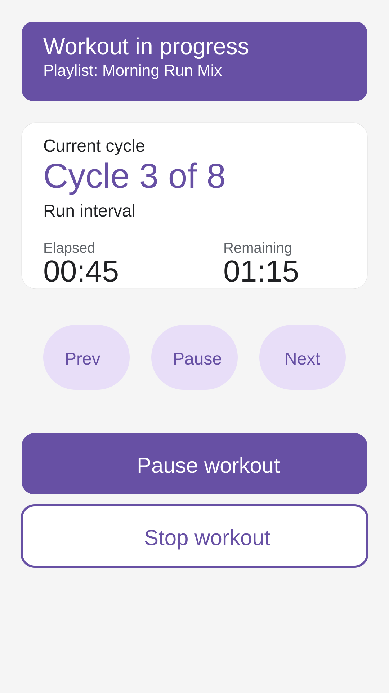

# C25K Custom Coach

C25K Custom Coach is a customizable Couch-to-5K training companion. Set your preferred run and walk intervals, define the total workout length or number of cycles, and choose optional warm-up and cool-down segments. The app keeps you on track with Material 3 UI controls, Text-to-Speech audio cues that duck other media, and a resilient foreground service that stays active even when the screen is off.

*Design mockup of the workout screen.*

## Why I built it

I built this for my wife. The Couch to 5K apps she tried locked her into their own plan, and she wanted her own run and walk intervals, cues she could hear over her music, and a timer that kept going with the screen locked.

## Features
- Adjustable run and walk interval lengths.
- Configure either a total workout duration or an explicit number of run/walk cycles.
- Optional three-minute warm-up and cool-down walks.
- Foreground service with a persistent notification offering pause, resume, and stop actions.
- Text-to-Speech prompts using the device locale while respectfully ducking other audio playback.
- Works when the device is locked, and exposes controls directly in the notification shade.

## Getting Started
1. Open the project in Android Studio Iguana or newer.
2. Sync Gradle to download dependencies (compileSdk 34, minSdk 26).
3. Build and run on a device or emulator with Google Play services for best TTS support.

From the main screen, enter your desired intervals and tap **Start workout** to begin. Use the notification controls or the in-app **Stop workout** button to finish early.

## Licence

Licensed under the Apache License 2.0. See [LICENSE](LICENSE).
